# PostgreSQL Schema Design — Task Tracker v1.2

**Status:** Implemented as the initial versioned PostgreSQL schema migration. Legacy records currently reside in the API-compatibility table; conversion into normalized entities remains pending.

**Target:** PostgreSQL 14 or newer, confirmed as the permanent database.

**Source review:** `backend/services/sheetsStore.js`, `backend/services/data.js`, `backend/routes/*.js`, and the v1.2 SRS data design and requirements.

## 1. Design goals

- Replace Google Sheets with PostgreSQL; Sheets is only a read-only migration source during the approved migration window.
- Normalize repeating and many-to-many data, enforce references in the database, and use transactions for multi-step changes.
- Preserve existing public API identifiers and existing behavior where it does not conflict with the v1.2 authorization and workflow requirements.
- Support all v1.2 entities, role/department scoping, unified task/issue work, milestones, backlog, attachments, notifications, audit, and durable email delivery.
- Keep secrets, uploaded file contents, and password hashes out of API responses and migration logs.
- Keep PostgreSQL IDs as `text` in the initial schema so existing Sheets IDs can be retained exactly. New IDs should be canonical UUID strings. This avoids changing identifiers during cutover; a later UUID conversion would be a separate migration.

## 2. Existing Google Sheets data and relationships

`SheetsStore.TABLES` defines eight tabs. Its header definitions are the authoritative current persistence fields:

| Sheets tab / logical collection | Current columns | Existing relationships and observations |
|---|---|---|
| `Users` / users | `_id`, `name`, `email`, `password`, `role`, `jobTitle`, `domain`, `phone`, `skills`, `reportingManager`, `assignedProjects`, `avatar`, `active`, `bootstrapAdmin`, `createdAt`, `updatedAt` | `reportingManager` refers to another user. `assignedProjects` is a JSON array of project IDs, separate from project membership. Normalize it and `Projects.members` into project membership records, preserving source and role semantics in the migration report. |
| `Projects` / projects | `_id`, `name`, `description`, `key`, `owner`, `members`, `status`, `createdAt`, `updatedAt` | `owner` refers to a user. `members` is a JSON array of user IDs. Issues/tasks/sprints/releases refer to projects. The current row does not contain department, dates, health, completion, or settings. |
| `Issues` / issues | `_id`, `title`, `description`, `project`, `reporter`, `assignee`, `status`, `severity`, `dueDate`, `issueNumber`, `foundInVersion`, `fixedInVersion`, `targetRelease`, `sprint`, `estimatedHours`, `timeLogs`, `attachments`, `comments`, `activity`, `reopenedCount`, `resolvedAt`, `createdAt`, `updatedAt` | `project`, `reporter`, `assignee`, and `sprint` refer to their respective records. `targetRelease` is a release reference/string and must be reconciled. `timeLogs`, `attachments`, `comments`, and `activity` are JSON arrays embedded on the issue row. |
| `Tasks` / tasks | `_id`, `title`, `description`, `project`, `reporter`, `assignee`, `status`, `priority`, `startDate`, `endDate`, `createdAt`, `updatedAt` | `project`, `reporter`, and `assignee` refer to other rows. No embedded comments, time logs, or attachments currently exist in this collection. |
| `Sprints` / sprints | `_id`, `name`, `project`, `startDate`, `endDate`, `goal`, `status`, `createdAt`, `updatedAt` | `project` refers to a project. Issues may carry a `sprint` reference; current sprint rows do not have task membership arrays. |
| `Releases` / releases | `_id`, `name`, `project`, `version`, `description`, `releaseDate`, `status`, `createdAt`, `updatedAt` | `project` refers to a project. Issue `targetRelease` may be a release ID or legacy value; verify against actual sheet data before mapping. |
| `Templates` / templates | `_id`, `name`, `type`, `body`, `fields`, `createdBy`, `createdAt`, `updatedAt` | `createdBy` refers to a user. `fields` is JSON. Current template collection has no project column; v1.2 permits optional project scope. |
| `Notifications` / notifications | `_id`, `type`, `issue`, `user`, `details`, `read`, `createdAt`, `updatedAt` | `issue` refers to an issue; `user` is the recipient. No actor, generic resource type/ID, or deduplication key currently exists. |

`backend/services/data.js` hydrates user, project, issue, and task references at read time. `publicUser` removes `password` and `bootstrapAdmin` from hydrated API data. These are service-level conventions, not database constraints.

### Important legacy data characteristics

- SheetsStore generates 32-hex-character IDs by removing hyphens from random UUIDs. Migration must preserve them verbatim as text.
- JSON fields (`assignedProjects`, `members`, `timeLogs`, `attachments`, `comments`, `activity`, `fields`) are serialized in cells. A malformed JSON cell currently fails parsing; the migration must report the tab, row, and field without copying sensitive contents into logs.
- Empty cells are parsed as absent values. Existing routes may write empty strings rather than SQL `NULL`.
- Emails are normalized to lowercase during registration, but historical rows may not be. Duplicate emails and project keys must be checked case-insensitively before unique constraints are installed.
- `issues.issueNumber` is assigned by counting existing issues in a project; there is no concurrency-safe uniqueness constraint in Sheets. PostgreSQL must enforce `UNIQUE (project_id, issue_number)` and allocate numbers transactionally.
- The source schema does not currently have departments, project memberships as rows, milestones, backlog, block links, audit log, attachment metadata table, email outbox, or v1.2 work-item fields.

## 3. Proposed entity model

The schema uses `work_items` as the common, stable parent for tasks and issues, with one-to-one `tasks` and `issues` subtype rows. This enables real foreign keys for comments, activity, attachments, time entries, milestone links, and blocker targets, instead of unsafe polymorphic IDs. `work_items.kind` is constrained to `task` or `issue`; subtype rows must be created/deleted in the same transaction. Use deferred constraint triggers or repository-level transaction validation to enforce exactly one subtype per work item.

All tables use `created_at timestamptz NOT NULL DEFAULT now()` and `updated_at timestamptz NOT NULL DEFAULT now()` where mutable. Application writes timestamps in UTC; a shared trigger/helper may update `updated_at`. Date-only business dates use PostgreSQL `date`, not timestamps. IDs and foreign IDs are `text` in v1 for source-ID compatibility.

### Core identity and access

| Table | Primary key and fields | Foreign keys, unique constraints, checks |
|---|---|---|
| `roles` | `code text PK`, `label text`, `rank smallint` | Seed exactly `super_admin`, `admin`, `manager`, `employee`, `trainee`; unique rank and code. |
| `departments` | `id text PK`, `name`, `head_user_id NULL`, `parent_department_id NULL`, `active`, timestamps | `head_user_id → users.id`; parent self-FK; unique `lower(name)`; prevent self-parent and hierarchy cycles. `RESTRICT` deletion while any user, project (owner department), or shared-project row references it. Deactivation is blocked until active users and active projects are reassigned; historical inactive references may remain. |
| `users` | `id text PK`, `name`, `email`, `password_hash`, `role_code`, `department_id NULL during migration / required after reconciliation`, `reporting_manager_id`, `mentor_id`, `job_title`, `domain`, `phone`, `skills`, `avatar`, `active`, `bootstrap_admin`, `token_version integer`, `must_change_password`, `email_task_assigned`, `email_task_completed`, timestamps | `role_code → roles.code`; self-references; department FK; unique `lower(email)`; `token_version >= 0`. Never return `password_hash`. Preserve bcrypt hashes during ordinary migration. Active production users require an approved department. |
| `manager_departments` | `manager_user_id`, `department_id`, `created_at` | Composite PK; both FKs cascade only when appropriate; manager FK has a policy/trigger guard that the user has manager role. Replaces `managedDepartments[]`. |
| `password_reset_tokens` | `id text PK`, `user_id`, `token_hash`, `expires_at`, `used_at`, `created_at` | `user_id → users.id ON DELETE CASCADE`; unique token hash; single-use enforced transactionally; store only a hash of the emailed reset token. |

`users.department_id` is nullable only for legacy migration staging. Production readiness requires all existing users to be assigned to an approved department or to an explicitly approved migration holding department. No implicit department is to be invented.

**User lifecycle:** Deactivation preserves the user record, attribution, comments, time entries, audit, and historical notifications. Increment `token_version` to revoke existing sessions. Before deactivation, atomically reassign project ownership to an eligible active owner; the DB cannot safely infer that replacement. Existing open-work behavior is unresolved: the PRD says prompt for reassignment, while SRS §6.4 says flag open work unassigned. Do not select either behavior until product resolves it. Deletion of a user is not the deactivation workflow and is restricted while referenced; use `RESTRICT` for business records, and retain audit actor identity as a nullable FK plus immutable actor snapshot.

**Project owner reassignment:** require a single transaction that validates the replacement as active and authorized for the project, updates `projects.owner_user_id`, records an audit event, and emits any required notification/outbox events. A user with owned projects cannot be deactivated until this operation succeeds. Project ownership must not use `ON DELETE SET NULL`.

### Projects and planning

| Table | Primary key and fields | Foreign keys, unique constraints, checks |
|---|---|---|
| `projects` | `id text PK`, `name`, immutable `key`, `description_html`, `description_text`, `owner_user_id`, `owning_department_id`, `start_date date`, `target_end_date date`, `status`, `settings jsonb`, `health_status`, `completion_email_sent_at`, timestamps | `UNIQUE (id, owning_department_id)`; owner/dept FKs `ON DELETE RESTRICT`; unique `lower(key)`; status check includes `planning`, `active`, `on_hold`, `completed`, `archived`, and `cancelled` (cancelled is required by PRD/SRS email rules although omitted from FR-PROJ-04); date order. `settings` contains validated completion mode, default estimate, health thresholds, optional email events/attachment setting. Owner must be active and eligible at assignment time; enforced by transaction plus a guard preventing deactivation while ownership remains. |
| `project_departments` | `project_id`, `department_id`, `share_type` (`shared`) | Composite PK; both FKs; a constraint trigger/transaction guard prevents a shared department from duplicating `projects.owning_department_id`. The owning department is stored once on `projects`; it is not duplicated as a membership row. |
| `project_members` | `project_id`, `user_id`, `project_role`, `trainee_full_view`, `added_by_user_id`, `added_at`, `active` | Composite PK `(project_id,user_id)`; FKs to project, user, and adding user; `project_role IN ('lead','member','viewer')`. Replaces `Projects.members`; captures v1.2 membership properties. |
| `project_stakeholders` | `project_id`, `user_id`, `added_by_user_id`, `created_at` | Composite PK; FKs `ON DELETE RESTRICT`; supports extra email stakeholders without duplicating project membership. |
| `milestones` | `id text PK`, `project_id`, `name`, `description_html`, `description_text`, `start_date`, `due_date`, `owner_user_id`, `status`, `sort_order`, `warnings_sent jsonb`, timestamps | `UNIQUE (id, project_id)`; project FK `ON DELETE CASCADE`; owner FK `ON DELETE RESTRICT`; status check `not_started/in_progress/completed/cancelled`; due date required; date validation. `overdue` is derived, not stored. |
| `backlog_items` | `id text PK`, `project_id`, `title`, `description_html`, `description_text`, `kind`, `estimate_hours`, `priority`, `milestone_id`, `rank`, `state`, `created_by_user_id`, `approved_by_user_id`, `approved_at`, `rejected_by_user_id`, `rejected_at`, `closing_remarks`, `reject_reason`, timestamps | `UNIQUE (id, project_id)`; project/creator/approver/rejector FKs; milestone composite FK `(milestone_id,project_id) → milestones(id,project_id)`; rank unique per project, with deferrable constraint or transactional two-phase rank updates; valid kind/state; proposed items record approval metadata. |
| `backlog_conversions` | `backlog_item_id`, `work_item_id`, `project_id`, `converted_by_user_id`, `converted_at` | `backlog_item_id` is PK; `work_item_id` unique; composite FKs `(backlog_item_id,project_id) → backlog_items(id,project_id)` and `(work_item_id,project_id) → work_items(id,project_id)`. This is the canonical one-to-one conversion record; task `fromBacklog` and backlog `convertedTo` API fields are projections of it. One transactional insert creates the work item, subtype and conversion row, preventing cross-project or duplicate conversion. |
| `sprints` | `id text PK`, `project_id`, `name`, `start_date`, `end_date`, `goal`, `status`, timestamps | `UNIQUE (id,project_id)`; project FK; valid date range and status. |
| `releases` | `id text PK`, `project_id`, `name`, `version`, `description_html`, `description_text`, `release_date`, `status`, timestamps | `UNIQUE (id,project_id)`; project FK; status check. Whether version is unique within a project is unresolved; do not add `UNIQUE(project_id,version)` until confirmed. |
| `templates` | `id text PK`, `project_id NULL`, `name`, `type`, `body_html`, `body_text`, `fields jsonb`, `created_by_user_id`, timestamps | Optional project FK; creator FK `ON DELETE RESTRICT`; project scope NULL means global. Schema validates `fields`; do not store executable markup. Covers existing template fields and SRS optional project scope. |

**Project lifecycle and deletion:** archive is the default closure and preserves records. Physical project deletion is restricted to Admin and above and requires the SRS confirmation mechanism. In one transaction, reject deletion if open tasks/issues exist unless the caller supplied the required confirmation value; confirm the exact meaning of `?confirm=<key>` before implementation. On authorized confirmed deletion, cascade project-owned memberships, stakeholders, milestones, backlog, work items/subtypes, comments, time entries, activity, blocker/dependency links, attachment metadata, sprints and releases. Keep audit history and user-owned notification/email history; resource FKs are removed with resource snapshots retained. Queue external object deletion after DB commit and retry it; do not perform irreversible object deletion before transaction success. `RESTRICT` on audit references is not used for project resources because historical audit rows must survive. Project deletion must also respect outbox/email retention requirements.

Projects currently allow free-form status strings; migrate them through an explicit, reviewed mapping. Do not silently map unknown statuses. Project membership currently exists both in `Projects.members` and `Users.assignedProjects`; reconcile under the approved policy and report mismatches.

### Work items, relationships, and history

| Table | Primary key and fields | Foreign keys, unique constraints, checks |
|---|---|---|
| `work_items` | `id text PK`, `project_id`, `kind`, `title`, `description_html`, `description_text`, `reporter_user_id`, `assignee_user_id NULL`, `status`, `priority`, `start_date`, `due_date`, `milestone_id NULL`, `sprint_id NULL`, `estimate_hours`, `rejected_by_user_id NULL`, `rejected_at`, `closing_remarks`, `reject_reason`, `completed_at`, timestamps | `UNIQUE(id,project_id)`, `UNIQUE(id,kind)`, and `UNIQUE(id,project_id,kind)`; project/reporter/assignee/rejector FKs; `kind IN ('task','issue')`; milestone FK `(milestone_id,project_id) → milestones(id,project_id)`; sprint FK `(sprint_id,project_id) → sprints(id,project_id)`; date and nonnegative estimate checks. This is the single source of truth for an item's optional milestone assignment; if the SRS requires multiple milestones per item, replace this FK with a many-to-many relation rather than duplicating both representations. |
| `tasks` | `work_item_id text PK`, `subtype_kind text NOT NULL DEFAULT 'task' CHECK (subtype_kind='task')`, `project_id`, `task_type`, `parent_task_id NULL`, `labels text[]` | Composite FKs `(work_item_id,subtype_kind) → work_items(id,kind)` and `(work_item_id,project_id) → work_items(id,project_id)`; `UNIQUE(work_item_id,project_id)`; same-project parent FK `(parent_task_id,project_id) → tasks(work_item_id,project_id)`; task type FK `(task_type,subtype_kind) → work_type_kinds(type_value,kind)`. Completion time is parent `work_items.completed_at`. Backlog origin is exposed through `backlog_conversions`, not duplicated. |
| `issues` | `work_item_id text PK`, `subtype_kind text NOT NULL DEFAULT 'issue' CHECK (subtype_kind='issue')`, `project_id`, `issue_number integer`, `issue_type`, `severity`, `found_in_version`, `fixed_in_version`, `target_release_id NULL`, `reopened_count integer`, `resolved_at`, `labels text[]` | Composite FKs to `work_items(id,kind)` and `(id,project_id)`; `UNIQUE(work_item_id,project_id)` and `UNIQUE(project_id,issue_number)`; release FK `(target_release_id,project_id) → releases(id,project_id)`; issue type FK `(issue_type,subtype_kind) → work_type_kinds(type_value,kind)`; nonnegative issue number/reopen count. Number allocation uses a project counter row or locked transaction. |
| `work_types` | `value text PK`, `label`, `icon`, `active`, `sort_order`, timestamps | Unique case-insensitive label; seed the shared vocabulary with compatible task and issue kinds. |
| `work_type_kinds` | `type_value`, `kind` | Composite PK `(type_value,kind)`; FK to `work_types`; kind check (`task`/`issue`). The task-type endpoint/view returns active types with the task kind; optional Admin management edits the shared registry. |
| `work_item_dependencies` | `project_id`, `work_item_id`, `depends_on_work_item_id`, `created_by_user_id`, `created_at` | Composite PK `(work_item_id,depends_on_work_item_id)`; both composite FKs `(work_item_id,project_id)` and `(depends_on_work_item_id,project_id) → work_items(id,project_id)`; dependent/source side has an additional FK `(work_item_id,project_id) → tasks(work_item_id,project_id)` because SRS places `dependsOn[]` on tasks. Target may be a task or issue. No self-dependency; detect cycles in a transaction/service. |
| `block_links` | `id text PK`, `project_id`, `blocker_issue_id`, `blocked_work_item_id NULL`, `blocked_milestone_id NULL`, `created_by_user_id`, `created_at` | Composite FK `(blocker_issue_id,project_id) → issues(work_item_id,project_id)`; exactly one blocked target via XOR `CHECK`; composite target FK to `(work_item_id,project_id)` or `(milestone_id,project_id)`; unique blocker/target keys via partial unique indexes. All targets must share project. A trigger validates blocker issue type is `blocker`; a deferred trigger enforces at least one link for a blocker issue. Rejected/resolved/closed links may remain for history, but only active blockers affect blocked-state/counts. Cycles/self-blocking are rejected by service/recursive validation. |
| `blocker_requests` | `id text PK`, `project_id`, `issue_work_item_id`, `requested_by_user_id`, `status`, `reviewed_by_user_id`, `reviewed_at`, `decision_reason`, timestamps | Same-project composite FK to `issues(work_item_id,project_id)`; user FKs; status `pending/approved/rejected`. Required for trainee blocker-request flow (FR-ISS-05), which was missing from the prior design. |
| `comments` | `id text PK`, `work_item_id`, `author_user_id`, `body_text`, `created_at`, `updated_at` | Work item/user FKs; plain-text per PRD decision; optional edit metadata if required. |
| `time_entries` | `id text PK`, `work_item_id`, `user_id`, `hours numeric(8,2)`, `note`, `work_date date`, `created_at` | Work item/user FKs; positive hours check; replaces issue `timeLogs[]`; task logging is supported by a shared work-item FK. |
| `activity_log` | `id text PK`, `work_item_id NULL`, `project_id`, `actor_user_id NULL`, `action`, `details`, `before jsonb`, `after jsonb`, `created_at` | Project-only events have NULL work item; item events include both IDs. Composite FK `(work_item_id,project_id) → work_items(id,project_id)` and project FK enforce consistency; CHECK requires a project. Actor FK uses `ON DELETE RESTRICT` for historical attribution. Work/project deletion cascades activity as child data; security audit is separate and retained. |

#### Subtype integrity (mandatory)

For each committed `work_items` row, there must be exactly one child row: one `tasks` row when `kind='task'`, or one `issues` row when `kind='issue'`. The composite subtype FK and fixed `subtype_kind` CHECK prevent a mismatching subtype; each subtype PK prevents duplicate rows of that subtype. Add **deferred constraint triggers** on `work_items`, `tasks`, and `issues` that validate affected IDs at transaction commit: if the parent still exists, exactly one matching subtype must exist; if the parent was deleted, no check is required. The trigger must also reject a subtype mutation that leaves the parent with zero/multiple subtype rows. Insert parent and subtype in one transaction. Do not rely on application validation as a substitute.

### Attachments, notifications, audit, and email

| Table | Primary key and fields | Foreign keys, unique constraints, checks |
|---|---|---|
| `attachments` | `id text PK`, `project_id`, `work_item_id NULL`, `backlog_item_id NULL`, `filename`, `mime`, `size_bytes`, `storage_key`, `status`, `uploaded_by_user_id`, `scan_status`, `created_at`, `linked_at` | Exactly one parent (`work_item_id` XOR `backlog_item_id`); composite parent FK to item/project; uploader FK; nonnegative size; status/scan enums; unique storage key. Metadata only; bytes remain in configured storage, not PostgreSQL/public static paths. A post-commit deletion queue handles object cleanup. |
| `notifications` | `id text PK`, `recipient_user_id`, `actor_user_id NULL`, `type`, `details`, `resource_snapshot jsonb`, `read_at`, `idempotency_key`, `created_at` | Recipient/actor FKs; unique nullable idempotency key. Resource snapshot is for display after resource deletion and is not authoritative. Optional resource link is in `notification_resources` below, with enforceable typed FKs. |
| `notification_resources` | `notification_id PK`, `project_scope_id`, `target_project_id NULL`, `work_item_id NULL`, `milestone_id NULL` | `notification_id → notifications`; `project_scope_id → projects.id`. Exactly one of `target_project_id`, `work_item_id`, `milestone_id` is non-NULL. Project target must equal `project_scope_id`; work/milestone targets use composite FK `(target_id,project_scope_id)` to enforce same-project. Resource deletion removes only this link row, leaving notification and snapshot. |
| `audit_log` | `id text PK`, `actor_user_id NULL`, `actor_snapshot jsonb`, `action`, `resource_type`, `resource_id`, `resource_snapshot jsonb`, `before jsonb`, `after jsonb`, `ip inet NULL`, `user_agent`, `created_at` | Actor FK `ON DELETE SET NULL`; resource identifiers/snapshots intentionally have no resource FK so audit history survives resource deletion. Append-only DB role and restricted reader role. Snapshots must not contain secrets or unredacted sensitive fields. |
| `email_outbox` | `id text PK`, `event_type`, `batch_id`, `subject`, `payload jsonb`, `status`, `attempts`, `next_attempt_at`, `last_error`, `idempotency_key`, `created_at`, `sent_at` | Unique idempotency key; bounded attempts and valid status. Claim with `FOR UPDATE SKIP LOCKED`; provider call outside transaction. Include an `email_resources` typed link table (one optional project/work-item/milestone target with real composite FKs) and immutable resource snapshot in payload; remove link on resource deletion, retaining durable delivery history. |
| `email_recipients` | `email_outbox_id`, `user_id NULL`, `email_snapshot`, `name_snapshot`, `recipient_type` (`to`/`cc`), `delivery_status`, `delivered_at` | Composite uniqueness for outbox/user or normalized email; user FK `ON DELETE SET NULL`; preserve delivery destination/name snapshot; deduplicate so a recipient in To is not also CC. |
| `email_attachments` | `email_outbox_id`, `attachment_id`, `delivery_mode`, `position` | Composite PK; outbox/attachment FKs; delivery mode `attached`/`secure_link`; enforces the email size cap in the mail service. |
| `email_resources` | `email_outbox_id PK`, `project_scope_id`, `target_project_id NULL`, `work_item_id NULL`, `milestone_id NULL` | `project_scope_id → projects.id`; same typed-target/XOR and composite same-project FK rules as `notification_resources`; link cascades on resource deletion while the outbox and immutable payload snapshot remain. |
| `storage_cleanup_jobs` | `id text PK`, `storage_key`, `status`, `attempts`, `next_attempt_at`, `last_error`, `created_at`, `completed_at` | Durable, idempotent post-commit cleanup for deleted/replaced attachment objects; unique active cleanup key as appropriate. Do not FK to attachment rows because the job must outlive attachment/project deletion. Never log credentials or signed URLs in `last_error`. |
| `saved_filters` | `id text PK`, `user_id`, `name`, `filters jsonb`, `created_at`, `updated_at` | User FK; unique `(user_id, lower(name))`; query contents are treated as user input and still pass visibility policies. |

### PostgreSQL data types and validation

- Use `text` IDs in initial migration; `text` names/emails with normalized lowercase email; `timestamptz` for instants; `date` for due/start dates; `numeric(8,2)` for estimates/time; `jsonb` only for genuinely flexible settings, snapshots, and payloads; typed columns for searchable/query-critical fields.
- Add `CHECK` constraints for enums/statuses, nonnegative sizes/counts/hours, start/end ordering where appropriate, valid recipient/resource state, and mutually exclusive attachment/blocker targets.
- Use FK behavior deliberately: restrict deleting referenced users/departments; never null project owner; cascade project-owned children only after authorization and deletion preconditions. For notification/email resource links, cascade only the typed link, keeping notification/outbox and immutable snapshots.
- Normalize labels into join tables if filtering/analytics requires querying individual labels; otherwise a `text[]` column is acceptable for non-relational tag values.
- Avoid keeping `members`, comments, activity, time logs, attachment paths, or recipient lists as large JSON arrays.

### SRS v1.2 entity/data coverage

The design represents the SRS data entities and their required relationships as follows; this is a schema coverage check, not a claim that implementation exists.

| SRS entity/data area | Proposed representation |
|---|---|
| Users, roles, departments, manager scope, reporting/mentor relationships | `users`, `roles`, `departments`, `manager_departments`; user self-FKs preserve manager/mentor references. |
| Projects, owners, departments, shared scope, members/stakeholders, project settings | `projects`, `project_departments`, `project_members`, `project_stakeholders`; SRS configuration fields are typed columns or validated settings keys. |
| Unified task/issue fields and discriminated subtype-specific fields | `work_items`, `tasks`, `issues`, `work_types`, `work_type_kinds`; database constraints enforce exactly one kind-matching subtype. |
| Work status, priority, estimates, dates, reporter/assignee, completion/rejection metadata | `work_items`; values and state transitions require SRS-aligned checks/service validation. |
| Dependencies, blocker issue links, trainee blocker requests | `work_item_dependencies`, `block_links`, `blocker_requests`; same-project FKs and typed targets. |
| Milestones, backlog and approval/rejection/closing remarks, sprints, releases | `milestones`, `backlog_items`, `backlog_conversions`, `sprints`, `releases`; same-project composite FKs where related. |
| Comments, activity, time logs, attachments | `comments`, `activity_log`, `time_entries`, `attachments`; uploaded bytes remain in external configured storage. |
| Notifications, read state, recipients, typed resource association | `notifications`, `notification_resources`; notification snapshots survive resource removal. |
| Email events, batching, delivery attempts, recipients and attachments | `email_outbox`, `email_recipients`, `email_attachments`, `email_resources`. |
| Templates and saved filters | `templates`, `saved_filters`. |
| Security audit and password-reset flows | `audit_log`, `password_reset_tokens`. |

Not represented as independent relational rows because the SRS does not require independent lifecycle/query behavior: flexible project settings, validated template field definitions, email payloads, audit before/after snapshots, and immutable notification/resource snapshots. Keep these JSON values schema-validated and redact them before persistence.

### Audit controls and retention

- Audit entries are append-only. The runtime DB role receives `INSERT` and narrowly scoped `SELECT`, but no `UPDATE`/`DELETE`; a separate migration/retention role handles approved maintenance. A trigger can provide defense in depth, but must not be bypassable by the application role.
- Restrict audit reads to the SRS-authorized roles/actions, log access to the audit facility if required by the security policy, and never expose audit JSON through general project/work endpoints.
- Redact passwords, password-reset tokens, JWTs, cookies, authorization headers, secrets, and sensitive personal fields before constructing `before`, `after`, `details`, `actor_snapshot`, or `resource_snapshot`. Store allowlisted change fields, not complete request bodies.
- Audit records must survive user and resource deletion. Keep actor/resource snapshots necessary for attribution; do not retain credentials or unnecessary personal data in snapshots.
- Retention period, archival destination, legal hold, and whether/how anonymization is required are unresolved policy decisions. Do not silently purge or invent a duration. Until decided, no automated retention deletion is proposed.

## 4. Index plan

Separate indexes mandated by integrity/explicit SRS needs from access-path candidates. Primary-key, unique-constraint and FK-supporting indexes described below are implemented with their constraints; PostgreSQL does not automatically index the referencing side of every FK.

### Immediate: integrity and SRS requirements

| Index or constraint-backed index | Why it is immediate |
|---|---|
| Unique `lower(users.email)`, `lower(departments.name)`, `lower(projects.key)` | Required case-insensitive uniqueness; prevents duplicate account, department and project identifiers. |
| Unique `(project_id, issue_number)` on `issues` | SRS issue numbering invariant and concurrent allocation correctness. |
| `tasks(project_id, task_type)` and `issues(project_id, issue_type)` | Explicit SRS FR-WORK-15 filtering dimensions. |
| Index on every frequently joined FK: user department/manager/mentor; project owner/owning department; project-department department; member user; work item project/reporter/assignee/milestone/sprint; milestone owner; backlog project/milestone/creator; sprint/release project; issue target release; notification recipient; attachment parent/uploader; audit actor; outbox recipient/resource links | Required to keep referential checks and SRS-scoped lookups operational; include only columns that are actual FKs and avoid duplicating a PK/unique index's leading columns. |
| `password_reset_tokens(user_id, expires_at)` | SRS reset-token lookup/expiry cleanup. |

### Immediate query indexes from SRS flows

| Index | Purpose |
|---|---|
| `project_members(user_id, project_id)` | Current user's project visibility; the PK `(project_id,user_id)` does not serve this reverse lookup. |
| `projects(owning_department_id, status)` and `project_departments(department_id, project_id)` | Scoped department project lists. |
| `work_items(project_id, kind, status)` | Project task/issue lists and status counts. |
| `work_items(assignee_user_id, status)` and `work_items(reporter_user_id, status)` | My Work and reported work flows. |
| `notifications(recipient_user_id, read_at, created_at DESC)` | Recipient-scoped notification list and unread count. |
| `email_outbox(status, next_attempt_at)` and unique `email_outbox(idempotency_key)` | Durable mail worker claim/retry and idempotency. |

### Candidate only: add after query-plan evidence

| Candidate | Evidence required before adding |
|---|---|
| `users(role_code, department_id, active)`; `manager_departments(department_id, manager_user_id)` | Admin/manager listing plans and row counts. |
| `work_items(project_id, due_date)`; `milestones(project_id, due_date)`; `milestones(status,due_date)` | Dashboard, due-date, and warning-job plans. |
| `backlog_items(project_id,state,rank)` | Backlog list/filter plans; uniqueness for rank is a separate business decision. |
| `issues(issue_type,severity)` | Add only if the FR-WORK-15 project-scoped index does not support observed filtering; consider `(project_id,issue_type,severity)` instead. |
| `attachments(work_item_id,created_at)` and `(backlog_item_id,created_at)` | File listing query plans; project-scoped parent indexes may be enough. |
| `audit_log(created_at)`, `(actor_user_id,created_at)`, `(resource_type,resource_id,created_at)`, `(action,created_at)` | Audit UI/API query patterns, retention partitioning decision, and expected volume. |
| `email_recipients(user_id,email_outbox_id)`; extra outbox recipient filters | Mail-history requirements and actual recipient query patterns. |

Use `EXPLAIN (ANALYZE, BUFFERS)` on representative, visibility-scoped queries with realistic data before adding candidate indexes. Verify index overlap and write amplification. Do not add speculative or duplicate indexes.

## 5. ER diagram

```mermaid
erDiagram
  ROLES ||--o{ USERS : assigns
  DEPARTMENTS ||--o{ USERS : primary_department
  USERS ||--o{ USERS : manages
  USERS ||--o{ MANAGER_DEPARTMENTS : manages
  DEPARTMENTS ||--o{ MANAGER_DEPARTMENTS : managed_by
  DEPARTMENTS ||--o{ DEPARTMENTS : parent_of
  USERS ||--o{ PROJECTS : owns
  DEPARTMENTS ||--o{ PROJECTS : owns
  PROJECTS ||--o{ PROJECT_DEPARTMENTS : shares
  DEPARTMENTS ||--o{ PROJECT_DEPARTMENTS : shared_with
  PROJECTS ||--o{ PROJECT_MEMBERS : has
  USERS ||--o{ PROJECT_MEMBERS : joins
  PROJECTS ||--o{ PROJECT_STAKEHOLDERS : has
  USERS ||--o{ PROJECT_STAKEHOLDERS : stakeholder
  PROJECTS ||--o{ MILESTONES : plans
  PROJECTS ||--o{ BACKLOG_ITEMS : captures
  MILESTONES o|--o{ BACKLOG_ITEMS : schedules
  PROJECTS ||--o{ SPRINTS : schedules
  PROJECTS ||--o{ RELEASES : publishes
  PROJECTS ||--o{ WORK_ITEMS : contains
  MILESTONES o|--o{ WORK_ITEMS : assigns
  SPRINTS o|--o{ WORK_ITEMS : assigns
  USERS ||--o{ WORK_ITEMS : reports
  USERS o|--o{ WORK_ITEMS : assigned_to
  WORK_ITEMS ||--o| TASKS : task_subtype
  WORK_ITEMS ||--o| ISSUES : issue_subtype
  RELEASES o|--o{ ISSUES : targets
  BACKLOG_ITEMS ||--o| BACKLOG_CONVERSIONS : converts
  WORK_ITEMS ||--o| BACKLOG_CONVERSIONS : created_as
  USERS ||--o{ BACKLOG_CONVERSIONS : converts
  TASKS ||--o{ WORK_ITEM_DEPENDENCIES : depends
  WORK_ITEMS ||--o{ WORK_ITEM_DEPENDENCIES : dependency_target
  ISSUES ||--o{ BLOCK_LINKS : blocks
  WORK_ITEMS o|--o{ BLOCK_LINKS : blocked_work
  MILESTONES o|--o{ BLOCK_LINKS : blocked_milestone
  USERS ||--o{ BLOCK_LINKS : creates
  ISSUES ||--o{ BLOCKER_REQUESTS : requested_for
  USERS ||--o{ BLOCKER_REQUESTS : requests
  WORK_ITEMS ||--o{ COMMENTS : has
  USERS ||--o{ COMMENTS : writes
  WORK_ITEMS ||--o{ TIME_ENTRIES : tracks
  USERS ||--o{ TIME_ENTRIES : logs
  WORK_ITEMS o|--o{ ACTIVITY_LOG : records
  PROJECTS o|--o{ ACTIVITY_LOG : records
  WORK_ITEMS o|--o{ ATTACHMENTS : owns
  BACKLOG_ITEMS o|--o{ ATTACHMENTS : owns
  USERS ||--o{ ATTACHMENTS : uploads
  USERS ||--o{ NOTIFICATIONS : receives
  USERS o|--o{ NOTIFICATIONS : triggers
  NOTIFICATIONS o|--o| NOTIFICATION_RESOURCES : links
  PROJECTS o|--o{ NOTIFICATION_RESOURCES : project_target
  WORK_ITEMS o|--o{ NOTIFICATION_RESOURCES : work_target
  MILESTONES o|--o{ NOTIFICATION_RESOURCES : milestone_target
  USERS o|--o{ AUDIT_LOG : acts
  EMAIL_OUTBOX ||--o{ EMAIL_RECIPIENTS : sends_to
  USERS ||--o{ EMAIL_RECIPIENTS : receives
  EMAIL_OUTBOX ||--o{ EMAIL_ATTACHMENTS : includes
  ATTACHMENTS ||--o{ EMAIL_ATTACHMENTS : delivered_as
  EMAIL_OUTBOX o|--o| EMAIL_RESOURCES : links
  PROJECTS o|--o{ EMAIL_RESOURCES : project_target
  WORK_ITEMS o|--o{ EMAIL_RESOURCES : work_target
  MILESTONES o|--o{ EMAIL_RESOURCES : milestone_target
  USERS ||--o{ TEMPLATES : creates
  PROJECTS o|--o{ TEMPLATES : scopes
  USERS ||--o{ SAVED_FILTERS : saves
```



The relationship lines do not encode composite key details: enforce same-project membership with composite FKs as specified above. The `work_items`/subtype relationship is exactly one-to-one at transaction commit, not merely optional one-to-one. The typed notification/email resource link rows each contain exactly one resource FK, enforced by CHECK constraints; their parent records and snapshots survive resource deletion.

## 6. Repository architecture proposal

Keep HTTP handlers independent of the PostgreSQL driver and make authorization decisions before data access. Suggested CommonJS layout consistent with the existing backend:

```text
backend/
  config.js
  server.js
  db/
    pool.js                 # pg Pool lifecycle and readiness check
    migrations/             # ordered, immutable SQL migrations
    transaction.js          # transaction helper
  repositories/
    usersRepository.js
    projectsRepository.js
    workItemsRepository.js
    milestonesRepository.js
    backlogRepository.js
    notificationsRepository.js
    auditRepository.js
    emailOutboxRepository.js
  services/
    authService.js
    authorizationPolicy.js
    projectService.js
    workItemService.js
    migrationService.js     # migration tooling, separate from runtime API
  routes/                   # HTTP validation + service call + response
  validation/               # request schemas
```

Responsibilities:

1. **Routes/controllers:** preserve API paths and response shapes where agreed; validate request shape; map stable domain errors to documented HTTP responses.
2. **Services:** implement multi-repository transactions, workflow state machines, permission checks, completion/health calculations, email/notification events, and migration-only orchestration.
3. **Policy layer:** one central `can(user, action, resource)`/scoped-query policy; list and aggregate repositories receive the server-computed scope and cannot broaden it using request filters.
4. **Repositories:** parameterized SQL only; explicit column mapping; no HTTP or JWT behavior. Provide query methods for every route use, not a generic Sheets-like predicate API.
5. **DB layer:** one bounded `pg.Pool`, startup configuration validation, transaction helper, graceful close, readiness check, and migration runner. Never log `DATABASE_URL` or query parameters that may contain sensitive data.
6. **Outbox workers:** claim email rows in short transactions with `FOR UPDATE SKIP LOCKED`; perform provider calls outside DB transactions; update attempts/backoff and sent status idempotently.

Do not implement every route by translating `store.list(...).filter(...)` to `SELECT *`. Use scoped SQL, pagination and aggregates to meet the SRS and prevent cross-project leaks.

## 7. Security and authorization dependencies

- Enforce the SRS five-role enum and the PRD permission matrix on the server, not just in React route guards.
- Centralize visibility rules for owning/shared departments, project owner/membership, and trainee item restrictions. Scope counts, exports, search, attachments, notifications, and analytics identically to ordinary reads.
- Treat not-visible resources as 404 and visible-but-forbidden actions as 403 as specified; audit sensitive denials.
- Use parameterized SQL through `pg`; never interpolate user-controlled query fragments. Whitelist sortable columns and filter operators.
- Keep password hashes bcrypt-compatible; reset tokens are random, single-use, time-limited, and stored hashed.
- Include `tokenVersion` in JWT claims and compare with the current user row on each authenticated request. Revoke tokens after role/department/active changes.
- Apply schema-library validation at every write boundary, reject unknown fields, and sanitize HTML server-side before persistence. Plain-text excerpts are derived server-side.
- Create transactions for user role changes, membership, issue numbering, backlog conversion/ranking, project completion/deletion, assignment/reassignment, attachment linking, and associated audit/outbox writes.
- Use least-privilege PostgreSQL roles: runtime role without schema ownership; migration role separate; backup/restore credentials separate. Restrict network access and require TLS where supported.
- Attachments are stored outside PostgreSQL and outside publicly served paths. Generate opaque storage keys, validate extension/size/count, track scan status, authorize every download/delete, set safe content disposition and `nosniff`.
- Enforce audit append-only behavior with database grants for the runtime role and, where needed, a database-side trigger; repository conventions alone are insufficient. Prevent secret/password/reset-token data from entering `before`, `after`, `payload`, logs or audit records.
- Select the SRS session approach before implementation: HttpOnly/Secure/SameSite cookies plus CSRF protection are preferred; if localStorage remains, document XSS risk and set strict CSP.
- Preserve Helmet, CORS allowlist, API/auth rate limits and add per-account failed-login throttling. Apply lockout without creating an account-enumeration oracle.

## 8. Proposed packages and configuration

Packages below are proposals, not installed. Confirm versions against the supported Node.js version and current manifests before implementation.

| Package | Purpose | Status |
|---|---|---|
| `pg` | PostgreSQL client/pool for the current CommonJS Express application. | Installed and used by `backend/config/db.js`. |
| `node-pg-migrate` | Versioned SQL/JavaScript database migrations. SQL migrations should be reviewable and run by a separate migration command. | Not selected; the repository uses the versioned SQL runner in `backend/db/migrate.js`. |
| `zod` | Runtime schemas for every route body/query/params, including strict unknown-field rejection. | Recommended; no schema library currently found. |
| `@azure/msal-node` | Microsoft Entra client-credentials tokens for Microsoft Graph email delivery. | Selected for outgoing email; configure `Mail.Send` application permission with admin consent. |
| `pino`, `pino-http` | Structured JSON application/request logging with request IDs and redaction. | Recommended for SRS observability. |
| `node-cron` | In-process scheduled milestone/outbox jobs if deployment guarantees one elected worker; otherwise use a separate worker/managed scheduler. | Conditional; deployment topology decision required. |
| `@aws-sdk/client-s3` | S3-compatible attachment storage if that is the selected object-storage provider. | Conditional; object-storage provider not specified. |

### Environment variables

| Variable | Requirement / handling |
|---|---|
| `DATABASE_URL` | Required PostgreSQL connection string per SRS. Secret; never log or commit. Validate TLS/connection settings for the deployment. |
| `DATABASE_POOL_MAX` | Optional operational pool size, bounded to deployment capacity; exact default should be chosen from hosting limits. |
| `DATABASE_SSL` | Deployment-specific TLS policy; do not silently disable certificate validation in production. |
| `MIGRATIONS_DATABASE_URL` | Optional separate least-privilege migration connection; preferable to runtime DDL privileges. |
| `JWT_SECRET`, `JWT_EXPIRES_IN` | Retained from v1; secret at least 32 characters and expiry no more than 12 hours. |
| `ALLOW_SELF_REGISTRATION`, `DEFAULT_SELF_REGISTER_ROLE` | SRS registration flags; default role `employee` if enabled. |
| `CLIENT_URL`, `PORT`, `NODE_ENV`, `MAX_UPLOAD_MB` | Retained v1 settings; validate and document. |
| `STORAGE_DRIVER`, `STORAGE_BUCKET` | SRS attachment backend configuration. Provider credentials should use provider-native secret injection rather than committed values. |
| `MS_TENANT_ID`, `MS_CLIENT_ID`, `MS_CLIENT_SECRET`, `MS_SENDER` | Microsoft Graph client credentials and sender mailbox; required at backend startup. Keep the client secret in the hosting secret manager and never log it. |
| `DEFAULT_TIMEZONE` | Organization timezone for date buckets, due rules and scheduled events; default `UTC` per SRS. |
| `NOTIFY_JOB_CRON`, `EMAIL_BATCH_WINDOW_SECONDS`, `EMAIL_MAX_ATTEMPTS` | SRS schedule, batch window (300 seconds default), and retry limit (5 default). |
| `MILESTONE_WARNING_DAYS`, `OVERDUE_REMINDER_DAYS` | SRS due warning thresholds (`3,1`) and overdue repeat interval (`7`). |
| `MAX_ATTACHMENTS_PER_ITEM`, `ATTACHMENT_BLOCKED_EXTENSIONS`, `EMAIL_MAX_ATTACHMENT_MB`, `EMAIL_ATTACH_EVENTS`, `STAGED_UPLOAD_TTL_HOURS` | SRS attachment count/type/email/staging rules; validate exact allowed values. |
| `DESCRIPTION_MAX_CHARS`, `REJECT_REMARKS_MIN_CHARS` | SRS validation limits (20,000 and 10 characters by default). |

Do not add real values to examples, source, migration fixtures, or documentation. Provide placeholders only and keep all credentials out of Git.
